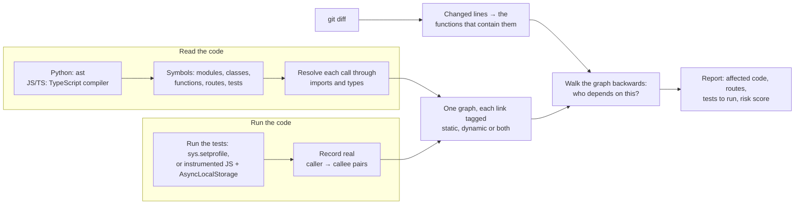

# Aftershock

Change one function, and what else shakes? Aftershock shows the **blast radius** of a change in a **Python, JavaScript or TypeScript** codebase before you merge: every function and API route that depends on it, which tests to run, and a 0–100 risk score.

**Live demo:** https://aftershock-iqny.onrender.com (free hosting: the first visit can take about a minute to wake up). Try a [TypeScript pull request report](https://aftershock-iqny.onrender.com/snapshots/4?base=main).

It reads the code **and** watches it run. Reading the code finds most dependencies. Running the tests finds the ones reading misses, such as functions called by name from a dictionary, event listeners, framework callbacks, and methods on objects whose type is only known at runtime. Measured on this project's own code, **15% of real calls were invisible to reading the code alone** (see [Accuracy](#accuracy)).


It comes as a command-line tool, a web API with a UI, and a GitHub Action that comments on pull requests.

---

## Try it in two minutes

```bash
git clone https://github.com/nikhilfiction/aftershock && cd aftershock
python3 -m venv venv && source venv/bin/activate      # Windows: venv\Scripts\activate
pip install -r requirements.txt && pip install -e .
pytest                                                  # 73 tests should pass
```

JavaScript and TypeScript also need Node.js 18 or newer. The first JS/TS scan installs the TypeScript compiler into `~/.cache/aftershock` (or run `aftershock setup-js` to do it now).

Then try it on the example shop app in `examples/shop_api`:

```bash
cd examples/shop_api
aftershock callers . decode_token
```

```
Blast radius: 27/100 (medium risk)
  - 4 symbols depend on this change (1 directly)
  - 3 API routes run the changed code

Direct dependents:
  app.auth.current_user

Distance 2:
  app.routes.orders.my_orders [ROUTE]
      via my_orders -> current_user -> decode_token
  ...

Tests to run (2):
  tests/test_shop.py::test_my_orders_lists_only_mine
  tests/test_shop.py::test_place_order_sends_receipt
```

### The part reading code can't do

`send_receipt` is called by name at runtime (`globals()[name](order)`), so reading the code finds nothing that depends on it:

```bash
aftershock callers . send_receipt
# Nothing depends on the changed code.  (no test reaches it)
```

Run the tests once with tracing, and ask again:

```bash
aftershock trace .
aftershock callers . send_receipt --trace .aftershock-trace.json
```

```
Hidden dependencies, found only by running the tests (3):
  app.services.hooks.run_hook
  app.services.orders.create_order
  app.routes.orders.place_order          <- a public API route
```

### The same in TypeScript

`examples/shop_js` is the same shop written with Express, TypeScript and Vitest. There, `sendReceipt` listens on an event bus (`events.on("order:placed", sendReceipt)`), so again no line of code shows who calls it:

```bash
cd examples/shop_js && npm ci
aftershock trace .
aftershock callers . sendReceipt --trace .aftershock-trace.json
```

```
Hidden dependencies, found only by running the tests (2):
  src.services.orders.createOrder
  src.routes.orders.POST /orders

Tests to run (2):
  tests/shop.test.ts::orders lists only my orders
  tests/shop.test.ts::orders sends a receipt when an order is placed
Run just these:
  npx vitest run tests/shop.test.ts -t '^(orders lists only my orders|orders sends a receipt when an order is placed)$'
```

A repository can mix languages, for example a Python API and a TypeScript frontend; both end up in one graph.

---

## Commands

| Command | What it does |
| --- | --- |
| `aftershock callers <repo> <name>` | Everything that depends on one function, class or route |
| `aftershock diff [repo] [--base main]` | The blast radius of your git changes. `--base HEAD` (default) = uncommitted work; `main...HEAD` = what your branch changed |
| `aftershock trace [repo]` | Run the repo's tests with tracing (pytest, and Vitest, Jest, Mocha or `node --test` from package.json); writes `.aftershock-trace.json` |
| `aftershock stats <repo>` | Counts of symbols and links, and how many were confirmed at runtime |
| `aftershock symbols <repo> [--kind route]` | List everything the scanner found |
| `aftershock serve` | Start the web app at http://localhost:8000 (API docs at http://localhost:8000/api/docs) |
| `aftershock setup-js` | Install the TypeScript compiler that reads JavaScript and TypeScript (otherwise done on first use) |

Useful options: `--trace FILE` (include runtime data), `--depth N` (how far to follow, default 3), `--format text|markdown|json`, `--fail-above 70` (exit code 1 above that risk, for CI).

---

## Web app

One server runs both the web app and its API. Build the web app once, then start the server:

```bash
cd ui && npm install && npm run build && cd ..   # builds into aftershock/web
aftershock serve                                # open http://localhost:8000
```

The API lives under `/api` on the same address, with interactive docs at http://localhost:8000/api/docs.

Add a repository (a GitHub https URL or a folder on your machine), scan a branch, then ask about a function, paste a diff, or compare against another branch like a pull request. The question goes into the address (`/snapshots/2?base=main` or `?fn=send_receipt`), so a report can be linked to.

Every report starts with a row of tiles, one number per finding: the risk score, what will break, what depends on the change, the API routes that run it, hidden dependencies and the tests to run. Each colour means one thing everywhere: blue is the change itself, grey is code that depends on it, purple was found only by running the tests, sky blue is an API route, red is deleted or will break, and green, orange or red is the risk level.

The **dependency radar** puts the change in the middle and everything that depends on it on rings, one ring per step away. Click a point to see where it is and how it reaches the change, or to analyze it on its own.

**Comparing a branch** reads like a pull request review: what will break and where it is still called, the radar with how the score adds up, the files the change touches, the diff, the affected routes (`GET /orders/` breaks, `POST /orders/` is 3 steps away) and the command for just the tests that matter (pytest, Vitest or Jest).


**One function** reads like an investigation: the radar, the call graph (callers above, what it uses below), and every caller with the line of code that calls it. For `send_receipt`, reading the code finds no caller at all; the tracer recorded `hook(order)` in `run_hook` while the tests ran.


On a phone the report becomes one column with tabs at the bottom for the radar, routes, tests and code.

---

## GitHub Action

Add `.github/workflows/aftershock.yml` to any Python, JavaScript or TypeScript repository (a ready-to-copy file is in `examples/github-workflow.yml`):

```yaml
on: pull_request
permissions:
  contents: read
  pull-requests: write
jobs:
  report:
    runs-on: ubuntu-latest
    steps:
      - uses: actions/checkout@v4
        with:
          fetch-depth: 0
      - uses: nikhilfiction/aftershock@main
        with:
          fail-above: "80"                          # optional
          trace: "true"                             # optional, runs your tests
          install: pip install -r requirements.txt  # needed when trace is on (JS/TS: npm ci)
```

Every pull request gets one comment with the report, updated on each push rather than adding new comments. The report also appears on the workflow's summary page, and the step exposes `score` and `level` as outputs. This repository uses the action on its own pull requests (`.github/workflows/aftershock.yml`).

---

## How it works



1. **Scan.** For Python, `scanner.py` parses each file with `ast`, records every module, class, function, method, route (detected from `@router.get` style decorators) and module-level variable, and builds an import table per file. It then walks every function body and turns each call into a link, resolving names through imports (including relative imports and aliases). Calls it can't resolve are kept, which is how it notices when you delete a function something still calls.

   For JavaScript and TypeScript, `js/scanner.cjs` runs in Node and uses the TypeScript compiler, which reads plain `.js` too. Its type checker says which declaration each call points at, across imports, re-exports, CommonJS `require` and method calls on typed objects (`store.insert()` links to `OrderStore.insert`). It finds functions, arrow functions, classes and methods, object-literal methods, routes (Express, Fastify and Hono style `router.get("/x", handler)`, NestJS `@Controller` + `@Get`, Next.js `route.ts` and `pages/api`) and test cases (`describe`/`it`/`test`). Names follow the Python style: `src/services/orders.ts` becomes `src.services.orders`, so the rest of the tool works the same for every language.
2. **Trace (optional).** For Python, `tracing.py` runs the test suite with a profiling hook that fires on every function call and records which project function called which. Calls that pass through library code, like a web framework invoking your dependency, are credited to the nearest project function.

   For JavaScript and TypeScript, `js_tracing.py` copies the project to a temporary folder (the original is never touched), installs dependencies if it has no `node_modules`, and inserts one call at the start of every function, on the same line so no line number moves. The test runner from `package.json` then runs with `js/runtime.cjs` preloaded, which keeps track of the current function with Node's `AsyncLocalStorage`. That carries across `await`, timers and event emitters, so a listener that runs when `createOrder` emits an event is recorded as called by `createOrder`. A request a test sends to a server it started is credited to that test.
3. **Map the diff.** `diff.py` reads `git diff` output and maps each changed line to the smallest function that contains it. Deleted functions are found by comparing the old and new versions of each file (JS/TS old versions are read by the same Node scanner).
4. **Analyze.** `analysis.py` walks the graph backwards from the changed functions (breadth-first, with distances), marks which affected functions are reachable only through runtime links (hidden dependencies), finds the tests that exercise the change, and scores the risk.

### The risk score

Four factors, each with a ceiling so no single factor can decide on its own:

| Factor | Max points | Measures |
| --- | --- | --- |
| Spread | 40 | How much code depends on the change; closer code counts more (1 / distance) |
| Routes | 30 | How many API routes end up running the changed code |
| Untested | 30 | The share of changed functions that no test reaches |
| Broken | 60 | Deleted functions that something still calls. One alone is enough for "high", because it is a guaranteed crash |

0–24 is low, 25–54 medium, 55 and up high.

---

## Accuracy

Measured by tracing this project's own test suite (`aftershock trace .` then `aftershock stats . --trace .aftershock-trace.json`). The exact numbers shift as the code changes; these are from version 1.0.0:

| | Links |
| --- | --- |
| Found by reading the code and confirmed at runtime | 207 |
| Found **only at runtime** (invisible to reading the code) | 36 |
| Found by reading the code, never run by any test | 254 |

So 36 of 243 real calls (15%) would be missed by a tool that only reads code. Most of them (27) are method calls on objects whose type is only known at runtime, for example `cache.get(...)` where `cache` arrives through FastAPI's `Depends`. The other 9 are SQLAlchemy calling a column's default function, a dictionary of functions picked by name, and functions passed as arguments that get called later. In the other direction, 254 links exist in code that no test runs, which is why the tool keeps both views instead of trusting runtime data alone.

---

## Project layout

```
aftershock/
  scanner.py        read Python: symbols, imports, calls
  javascript.py     run the JS/TS scanner with Node, install TypeScript on first use
  js/scanner.cjs    read JavaScript and TypeScript with the TypeScript compiler
  js/runtime.cjs    record real calls while JS/TS tests run
  project.py        scan and trace every language in a folder, joined into one result
  tracing.py        run Python tests: record real calls
  js_tracing.py     run JS/TS tests (Vitest, Jest, Mocha, node --test) on an instrumented copy
  pytest_plugin.py  starts the tracer inside pytest
  graph.py          NetworkX graph, reverse traversal
  diff.py           git diff -> changed and deleted functions
  analysis.py       affected code, tests to run, risk score
  render.py         text, Markdown and JSON reports
  github.py         pull request comments
  cli.py            the aftershock command
  api/              FastAPI app, database models, scan worker, cache
  web/              the built web app (made by `npm run build` in ui/, not in git)
ui/                 React + TypeScript web app
examples/shop_api/  small Python app with one deliberately hidden dependency
examples/shop_js/   the same app in TypeScript with Express and Vitest
action.yml          the GitHub Action
tests/              73 Python tests (the UI has 48 more in ui/src/test)
```

## Tests

```bash
pytest                     # 73 Python tests
cd ui && npm test          # 48 UI tests
```

## Known limits

- Python, JavaScript and TypeScript. The graph, analysis and UI don't depend on the language, so another language needs only a new scanner.
- In Python and plain JavaScript, reading the code can't always tell the type of a variable, so `obj.save()` is not linked to a specific `save` unless tracing sees it run (in JavaScript it is linked when only one method in the project has that name). TypeScript's types remove most of these gaps.
- A router's prefix set where it is mounted (`app.use("/api", router)`, `include_router(prefix=...)`) is not added to the route's path.
- Tracing only sees code that the tests run. Python tracing needs the project's dependencies installed; JavaScript tracing installs them into its temporary copy when needed.
- JavaScript runtime links have no line number: the runtime knows which function called, not from which line. A link that reading the code also found keeps the line from the code.
- Tracing executes the repository's code. Only enable it for repositories you trust.
